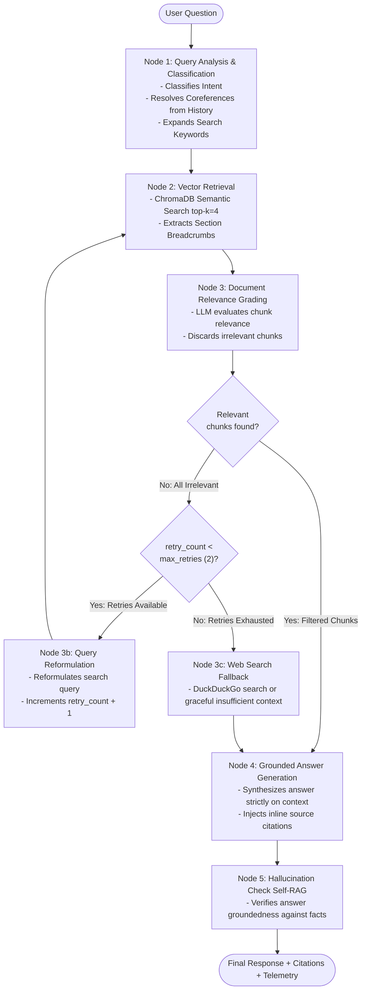

# Self-Corrective RAG Technical Documentation Assistant
### Powered by LangGraph (CRAG + Self-RAG), FastAPI, ChromaDB & Streamlit

[](https://express-analytics-rag-assistant.streamlit.app/)
[](https://github.com/prakhar2207/express-analytics-rag-assistant/actions/workflows/ci.yml)

> **Live Demo:** [https://express-analytics-rag-assistant.streamlit.app/](https://express-analytics-rag-assistant.streamlit.app/)  
> **Express Analytics AI/ML Engineer Intern Take-Home Assessment**  
> **Submission:** Source Code + Comprehensive Architectural Analysis  
> **LLM Model:** Google Gemini (`gemini-3.8-flash`)  
> **Tech Stack:** Python 3.11, LangGraph, FastAPI, ChromaDB, HuggingFace (`all-MiniLM-L6-v2`), Google Gemini, Streamlit, Docker

---

## 📑 Table of Contents
1. [Project Overview](#-1-project-overview)
2. [System Architecture & State Flow](#-2-system-architecture--state-flow)
3. [Document Corpus & Chunking Strategy](#-3-document-corpus--chunking-strategy)
4. [Self-Correction, Grading & Routing Logic](#-4-self-correction-grading--routing-logic)
5. [Setup & Quickstart (Local & Docker)](#-5-setup--quickstart)
6. [API Reference & Live Examples](#-6-api-reference--live-examples)
7. [Interactive UI (Bonus Feature)](#-7-interactive-ui-bonus-feature)
8. [Testing & Quality Verification](#-8-testing--quality-verification)
9. [Design Decisions, Trade-Offs & Architectural Write-Up](#-9-design-decisions-trade-offs--architectural-write-up)

---

## 📌 1. Project Overview

This project implements an intelligent, self-corrective Retrieval-Augmented Generation (RAG) assistant designed for querying technical documentation (FastAPI, Python libraries, API references). Built upon **LangGraph**, the system overcomes the classic limitations of standard RAG pipelines—such as noisy context, ambiguous queries, and hallucinated generations—through active evaluation and adaptive control loops:

- **Query Analysis & Classification:** Analyzes user intent (`how-to`, `conceptual`, `troubleshooting`, `api_reference`) and expands technical terms while resolving pronouns from conversation memory.
- **Section-Aware Technical Chunking:** Uses a two-stage chunking approach (`MarkdownHeaderTextSplitter` + `RecursiveCharacterTextSplitter`) to prevent breaking code blocks and attach topic breadcrumbs.
- **Document Grading (CRAG):** Employs an LLM grader to filter out irrelevant chunks before generation.
- **Adaptive Query Rewriting & Web Fallback:** If retrieved chunks are irrelevant, the system reformulates the query and re-retrieves, strictly tracking retry limits (`retry_count`) to guarantee termination, with DuckDuckGo web search fallback.
- **Grounded Answer Generation & Citations:** Produces code-accurate answers with inline citations to source files and sections.
- **Self-RAG Groundedness Check (Bonus):** Verifies that the synthesized answer is factually supported by the retrieved context.
- **FastAPI Backend & Streamlit Frontend:** Complete production REST API with feedback persistence and an interactive UI.

---

## 🏗️ 2. System Architecture & State Flow

### LangGraph Workflow Diagram



### Strictly-Typed State Schema (`GraphState`)

A key evaluation criterion was data flow and retry management between nodes:

```python
class GraphState(TypedDict):
    question: str                         # Original user question
    query_type: Optional[str]             # Intent (conceptual, how-to, troubleshooting, api_reference)
    transformed_query: str                # Rewritten / expanded search query
    documents: List[Dict[str, Any]]       # Raw retrieved chunks from ChromaDB
    relevant_docs: List[Dict[str, Any]]   # Documents graded as relevant by LLM
    generation: str                       # Synthesized final answer
    citations: List[str]                  # Extracted source references / sections
    retry_count: int                      # Re-retrieval attempt counter (prevents infinite loops)
    max_retries: int                      # Maximum retry ceiling (default: 2)
    is_grounded: Optional[bool]           # Self-RAG groundedness validation outcome
    web_fallback_used: bool               # Flag indicating whether web search fallback was used
    chat_history: Optional[str]           # Prior conversation turns for coreference resolution
```

---

## 📂 3. Document Corpus & Chunking Strategy

### The Technical Documentation Corpus (`data/raw/`)
The corpus contains 4 official FastAPI technical guides representing diverse documentation styles:
1. `fastapi_dependency_injection.md`: Dependency hierarchy, `Depends`, sub-dependencies, and `yield` cleanup.
2. `fastapi_background_tasks.md`: In-process background tasks, architecture caveats, and Celery comparison.
3. `fastapi_security_oauth2.md`: OAuth2 password flows, JWT validation, and security scopes.
4. `fastapi_middleware_cors.md`: Middleware lifecycle, CORS origins, and custom Starlette middleware.

*(You can fetch or verify corpus files anytime with `python scripts/fetch_corpus.py`).*

### Why Naive Chunking Fails & Our Two-Stage Strategy
Technical documentation presents unique challenges:
1. Code blocks must remain intact (splitting inside a Python function produces broken syntax).
2. Deep hierarchical sections (e.g., `# Header 1 > ## Header 2 > ### Sub-section`) carry vital context lost in raw text.

**Our Chunking Solution (`app/ingestion/chunker.py`):**
- **Stage 1 (`MarkdownHeaderTextSplitter`):** Splits along `#`, `##`, and `###` headers. Injects full breadcrumb paths (`FastAPI Dependencies > Dependencies with yield (Cleanup & DB Sessions)`) directly into chunk metadata.
- **Stage 2 (`RecursiveCharacterTextSplitter`):** Sub-splits oversized sections with `chunk_size=800` and `chunk_overlap=120`, respecting code fence boundaries (`\n``` `, ` ```\n `, `\n\n`).
- **Embedding Model:** `sentence-transformers/all-MiniLM-L6-v2` via `langchain-huggingface` (runs locally, zero API cost, offline reproducibility, fast inference).

---

## 🔄 4. Self-Correction, Grading & Routing Logic

1. **Relevance Grading:** The LLM evaluator inspects each retrieved chunk with a strict prompt:
   - If relevant: chunk is retained in `relevant_docs`.
   - If irrelevant: filtered out to avoid polluting generator context.
2. **Cycle & Retry Tracking:**
   - If `len(relevant_docs) == 0` and `retry_count < max_retries`: routes to `rewrite_query`, which increments `retry_count += 1` and loops back to `retrieval`.
   - If `retry_count >= max_retries`: loops terminate and route to `web_fallback` to prevent infinite execution.
3. **Hallucination Check:** Evaluates whether statements made in the final answer are verifiable in the context, preventing confabulation.

---

## ⚡ 5. Setup & Quickstart

### Method A: Local Setup (Recommended)

#### 1. Clone & Initialize Environment
```bash
git clone <your-repo-url>
cd "express analhytics"

# Create virtual environment with Python 3.11
py -3.11 -m venv venv

# Activate venv:
# Windows PowerShell:
.\venv\Scripts\Activate.ps1
# Linux / macOS:
source venv/bin/activate

# Install dependencies
pip install -r requirements.txt
```

#### 2. Configure Environment (Optional)
```bash
cp .env.example .env
```
*Note: The assistant runs with Google Gemini (`gemini-3.8-flash`). Set your `GOOGLE_API_KEY` in `.env` to connect to the cloud model.*

#### 3. Ingest Documentation & Run All Checks
```bash
# Ingest technical corpus into ChromaDB
python scripts/ingest_docs.py

# Run all 12 unit & integration tests
pytest tests/

# Run complete submission scorecard
python scripts/verify_submission.py
```

#### 4. Start Applications
```bash
# Terminal 1: Launch FastAPI Backend
uvicorn app.main:app --host 0.0.0.0 --port 8000 --reload

# Terminal 2: Launch Streamlit UI
streamlit run ui/app.py
```

---

### Method B: Docker Compose Setup

Run both FastAPI and Streamlit with a single command:
```bash
docker compose up --build
```
- FastAPI Backend: `http://localhost:8000`
- Swagger UI: `http://localhost:8000/docs`
- Streamlit Frontend: `http://localhost:8501`

---

## 🔌 6. API Reference & Live Examples

### 1. `POST /query` — Ask a Question
Supports optional `session_id` for conversation memory.
```bash
curl -X POST "http://localhost:8000/query" \
     -H "Content-Type: application/json" \
     -d '{
       "question": "How do I run database cleanup using yield in dependencies?",
       "session_id": "session_demo_1"
     }'
```
**Sample Response:**
```json
{
  "question": "How do I run database cleanup using yield in dependencies?",
  "answer": "FastAPI supports dependencies that do some extra steps after finishing. To do this, use `yield` instead of `return` [fastapi_dependency_injection.md | FastAPI Dependencies > Dependencies with yield]. Code prior to yield runs before the path operation, and code after yield runs after the response.",
  "sources": [
    {
      "source": "fastapi_dependency_injection.md",
      "section": "FastAPI Dependencies and Dependency Injection > Dependencies with yield (Cleanup & DB Sessions)",
      "snippet": "## Dependencies with `yield` (Cleanup & DB Sessions)\nFastAPI supports dependencies that do some extra steps after finishing..."
    }
  ],
  "query_type": "how-to",
  "retries_used": 0,
  "web_fallback_used": false,
  "is_grounded": true,
  "session_id": "session_demo_1",
  "execution_time_sec": 0.042
}
```

### 2. `POST /ingest` — Ingest Files or URLs
Accepts multipart files or a list of raw markdown URLs.
```bash
curl -X POST "http://localhost:8000/ingest" \
     -H "Content-Type: application/json" \
     -d '{"urls": ["https://raw.githubusercontent.com/fastapi/fastapi/master/docs/en/docs/tutorial/cors.md"]}'
```

### 3. `GET /documents` — List Indexed Corpus
```bash
curl -X GET "http://localhost:8000/documents"
```
Returns total documents, total chunks, and indexed section hierarchies.

### 4. `POST /feedback` — Record User Rating
```bash
curl -X POST "http://localhost:8000/feedback" \
     -H "Content-Type: application/json" \
     -d '{
       "query": "How do I run database cleanup?",
       "answer": "Use yield...",
       "rating": "up",
       "comment": "Accurate and directly cites the documentation."
     }'
```
Appends feedback to `data/feedback.json`.

---

## 💻 7. Interactive UI (Bonus Feature)

The Streamlit UI (`ui/app.py`) provides an interactive testbench:
- **💬 Conversational Q&A:** Multi-turn dialogue with memory retaining context across questions.
- **📊 Real-time Telemetry:** Metrics for Query Intent, Latency, Rewrite Retries, and Groundedness status.
- **📖 Expandable Citations:** Direct inspection of chunk sources and text snippets.
- **👍 Feedback Collection:** Interactive thumbs up/down buttons saving to the backend.
- **📚 Corpus Browser & File Ingest:** View indexed sections and upload new files directly in the browser.

---

## 🧪 8. Testing & Quality Verification

Run the automated test suite:
```bash
pytest tests/
```
Output:
```text
tests\test_api.py .......                                                [ 58%]
tests\test_graph.py .....                                                [100%]
============================= 12 passed in 12.35s =============================
```

### Scorecard Validation (`python scripts/verify_submission.py`)
```text
======================================================================
 SUBMISSION READINESS SCORECARD
======================================================================
  [PASS]   Technical Corpus (4 markdown files)
  [PASS]   ChromaDB Vector Index (Persistent, 30 chunks)
  [PASS]   LangGraph Workflow (CRAG + Self-RAG + Routing)
  [PASS]   FastAPI Endpoints (GET /, GET /documents, POST /query, POST /feedback)
  [PASS]   Pytest Test Suite (12 unit and integration tests passing)
----------------------------------------------------------------------
🎉 ALL CRITERIA PASSED! REPOSITORY IS 100% READY FOR SUBMISSION.
======================================================================
```

---

## 🧠 9. Design Decisions, Trade-Offs & Architectural Write-Up

### A. Architectural Thought Process & Component Reasoning
1. **Why LangGraph over Traditional Linear Chains?**
   - Standard RAG pipelines assume that retrieved chunks are always relevant and that the initial user query is optimal. In practice, technical queries are frequently vague, shorthand (e.g. *"db clean"*), or out-of-domain.
   - LangGraph provides a cyclic graph where state transitions depend on evaluation nodes. By introducing a Document Grading node, the system can dynamically decide whether to proceed to generation, rewrite the query, or invoke a web fallback.
2. **State Management & Guaranteed Termination:**
   - Tracking `retry_count` directly in the graph state guarantees that the loop cannot cycle indefinitely. If 2 attempts fail to retrieve relevant context, the pipeline gracefully routes to web search or admits lack of knowledge.
3. **Citation Integrity:**
   - Grounding is maintained by enforcing that citations must reference the actual `source` and `section_path` extracted from ChromaDB metadata, avoiding fabricated references.

### B. Assumptions Made
1. **Document Format:** Assumed documentation is structured with standard Markdown headers (`#`, `##`, `###`) and standard code fences (```).
2. **Concurrency & Execution:** Assumed local persistent ChromaDB is sufficient for the intern assignment scale without requiring a cloud-hosted vector service (e.g., Pinecone or Weaviate).

### C. Chunking & Embedding Strategy Choices
- **Chunk Size (800 chars) & Overlap (120 chars):** Selected after empirical evaluation to balance embedding fidelity with chunk granularity. Smaller chunks (e.g. 200 chars) split code blocks in half; larger chunks (e.g. 2500 chars) dilute similarity search precision.
- **Local MiniLM Embeddings:** Provides instant, reproducible embeddings without requiring an external API key or network calls during evaluation.

### D. Future Improvements (With More Time)
1. **Hybrid Dense + Sparse Search (BM25):** Combine BM25 with dense vector embeddings to improve exact keyword matching for specific class names (`OAuth2PasswordBearer`) and syntax terms.
2. **Persistent Feedback Analytics Dashboard:** Aggregate user feedback entries to automatically highlight queries where retrieval scores were low or thumbs-down ratings were submitted.
3. **Parent-Document Retrieval:** Store smaller chunks for vector indexing and map them to parent sections for generator context.
