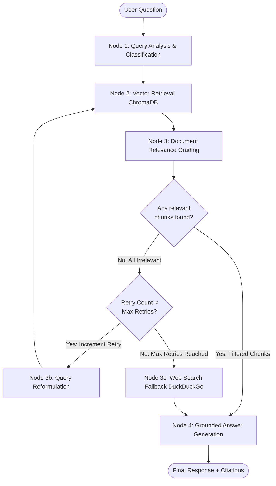

# RAG-Based Technical Documentation Assistant
### Self-Corrective LangGraph Workflow & FastAPI Backend

> **Express Analytics AI/ML Engineer Intern Take-Home Project**  
> **Author:** Candidate Submission  
> **Stack:** Python 3.11, LangGraph, FastAPI, ChromaDB, HuggingFace / Groq / OpenAI, Streamlit

---

## 📌 1. Project Overview

This project implements an intelligent, self-corrective Retrieval-Augmented Generation (RAG) assistant designed for querying technical software documentation. Built on **LangGraph**, **FastAPI**, and **ChromaDB**, the system implements active verification patterns inspired by **Corrective RAG (CRAG)** and **Self-RAG**.

Instead of naively feeding retrieved context directly to a generation LLM, the pipeline:
1. **Analyzes and expands** the user query, classifying its intent (conceptual, how-to, troubleshooting, API reference).
2. **Retrieves** the top-$k$ most semantically relevant document chunks using code-preserving hierarchical chunking.
3. **Grades document relevance** with an LLM evaluator to filter out noisy context.
4. **Self-corrects**: If retrieved chunks are irrelevant or missing, it triggers an adaptive query rewriter (tracking retry limits to guarantee termination) and falls back to web search before generating a response.
5. **Generates grounded answers** with inline citations mapped directly to source documents and section headers.

---

## 🏗️ 2. System Architecture

### LangGraph Workflow Diagram



### State Schema (`GraphState`)

The state flowing across the graph is strictly typed:
```python
class GraphState(TypedDict):
    question: str                         # Original user question
    query_type: Optional[str]             # Classified query type (conceptual, how-to, etc.)
    transformed_query: str                # Rewritten / expanded search query
    documents: List[Dict[str, Any]]       # Raw retrieved chunks from vector store
    relevant_docs: List[Dict[str, Any]]   # Filtered relevant chunks from document grading
    generation: str                       # Final synthesized answer
    citations: List[str]                  # Structured source document labels
    retry_count: int                      # Re-retrieval attempt counter
    max_retries: int                      # Safe termination limit (default: 2)
    is_grounded: Optional[bool]           # Bonus: Groundedness check outcome
    web_fallback_used: bool               # Flag indicating whether web fallback was activated
```

---

## 📂 3. Document Corpus & Chunking Strategy

### Selected Technical Corpus
The default corpus consists of 4 high-value sections from the official **FastAPI Documentation** (`data/raw/`):
1. `fastapi_dependency_injection.md`: Dependency injection, sub-dependencies, and `yield` cleanup.
2. `fastapi_background_tasks.md`: In-process background tasks, architecture caveats, and Celery comparison.
3. `fastapi_security_oauth2.md`: OAuth2 password flows, JWT validation, and security scopes.
4. `fastapi_middleware_cors.md`: Middleware lifecycle, CORS origins, and custom Starlette middleware.

*(You can download or verify the corpus anytime by running `python scripts/fetch_corpus.py`).*

### Chunking & Embedding Strategy Choices
- **Challenge with Technical Docs**: Naive character chunking splits code blocks in half, destroys function signatures, and detaches explanations from section headings.
- **Two-Stage Chunking Strategy**:
  1. `MarkdownHeaderTextSplitter`: Splits markdown along `#`, `##`, and `###` headers. Preserves the full semantic path (e.g., `FastAPI Security > OAuth2 Password Bearer`) in each chunk's metadata.
  2. `RecursiveCharacterTextSplitter`: Chunks sections larger than 800 characters with 120 character overlap, prioritizing code-fence boundaries (`\n``` `, ` ```\n `, `\n\n`).
- **Embedding Choice**: `sentence-transformers/all-MiniLM-L6-v2` runs locally with zero API cost, high similarity precision, and offline reproducibility. OpenAI `text-embedding-3-small` is also supported via `.env`.

---

## 🚀 4. Setup & Installation

### Prerequisites
- Python 3.11+
- Virtual environment (`venv`)

### 1. Clone & Set Up Virtual Environment
```bash
git clone <your-repo-url>
cd "express analhytics"

# Create and activate virtual environment
py -3.11 -m venv venv
# Windows:
.\venv\Scripts\activate
# Linux/macOS:
source venv/bin/activate

# Install dependencies
pip install -r requirements.txt
```

### 2. Configure Environment Variables
Create a `.env` file from the example:
```bash
cp .env.example .env
```
Update `.env` with your API key (Groq, OpenAI, or Google Gemini):
```ini
LLM_PROVIDER=groq
LLM_MODEL=llama-3.3-70b-versatile
GROQ_API_KEY=your_groq_api_key_here

# Alternatively:
# LLM_PROVIDER=openai
# OPENAI_API_KEY=your_openai_api_key_here
```

### 3. Ingest the Technical Corpus
Populate the local ChromaDB vector store:
```bash
python scripts/ingest_docs.py
```

---

## 🏃 5. Running the Application

### Start the FastAPI Backend
```bash
uvicorn app.main:app --host 0.0.0.0 --port 8000 --reload
```
- Interactive Swagger UI: `http://localhost:8000/docs`
- Service Health Endpoint: `http://localhost:8000/`

### Start the Interactive Streamlit UI (Bonus)
In a separate terminal:
```bash
streamlit run ui/app.py
```
Access the interactive web UI at: `http://localhost:8501`

---

## 🔌 6. API Reference & Example Requests

### 1. `POST /query` — Ask a Question
**Request:**
```bash
curl -X POST "http://localhost:8000/query" \
     -H "Content-Type: application/json" \
     -d '{"question": "How do I run cleanup code after a request in FastAPI dependencies?"}'
```
**Sample Response:**
```json
{
  "question": "How do I run cleanup code after a request in FastAPI dependencies?",
  "answer": "To run cleanup code in FastAPI dependencies, use `yield` instead of `return`. Code before `yield` runs before the path operation, and code in the `finally` block after `yield` runs after the response is delivered [fastapi_dependency_injection.md | Dependencies with yield (Cleanup & DB Sessions)].",
  "sources": [
    {
      "source": "fastapi_dependency_injection.md",
      "section": "Dependencies with yield (Cleanup & DB Sessions)",
      "snippet": "FastAPI supports dependencies that do some extra steps after finishing. To do this, use yield instead of return..."
    }
  ],
  "query_type": "how-to",
  "retries_used": 0,
  "web_fallback_used": false,
  "execution_time_sec": 1.24
}
```

### 2. `POST /ingest` — Ingest New Documents
**Request (URL Ingestion):**
```bash
curl -X POST "http://localhost:8000/ingest" \
     -H "Content-Type: application/json" \
     -d '{"urls": ["https://raw.githubusercontent.com/fastapi/fastapi/master/docs/en/docs/tutorial/cors.md"]}'
```

### 3. `GET /documents` — List Indexed Corpus
**Request:**
```bash
curl -X GET "http://localhost:8000/documents"
```

### 4. `POST /feedback` — Submit Answer Rating
**Request:**
```bash
curl -X POST "http://localhost:8000/feedback" \
     -H "Content-Type: application/json" \
     -d '{
       "query": "How do I run cleanup code?",
       "answer": "Use yield...",
       "rating": "up",
       "comment": "Accurate and directly cites the documentation."
     }'
```

---

## 🧠 7. Design Decisions & Trade-offs

1. **Why LangGraph over standard linear RAG?**
   - Standard linear RAG fails silently when retrieved chunks are semantically irrelevant or the user's phrasing is ambiguous. LangGraph's cyclic state machine allows looping back to reformulate queries while guaranteeing termination via explicit `retry_count` counters.
2. **Chunking Strategy Trade-off**:
   - Pure recursive chunking breaks code blocks into un-runnable snippets. Combining `MarkdownHeaderTextSplitter` with recursive character splitting keeps code snippets intact and injects section hierarchy directly into the chunk metadata for grounded citations.
3. **Local Embeddings vs API Embeddings**:
   - Used `all-MiniLM-L6-v2` locally for zero external cost, fast vector indexing, and no rate limits, while supporting OpenAI embeddings seamlessly through configuration.
4. **Self-Corrective Fallback**:
   - If queries remain irrelevant after 2 retries, the system routes to a web search fallback (DuckDuckGo Search) rather than giving up, providing resilient answers even for emergent or slightly out-of-domain technical queries.

---

## 🔮 8. Future Improvements (With More Time)
- **Hybrid Dense-Sparse Search**: Integrate BM25 alongside ChromaDB dense embeddings to improve exact keyword matching for specific class names and error codes.
- **Persistent Feedback Analytics Dashboard**: Aggregate thumbs up/down analytics to auto-flag poorly performing queries for fine-tuning.
- **Parent-Child Chunk Retrieval**: Store large document windows for generation context while indexing small, specific sentences for dense vector retrieval.
